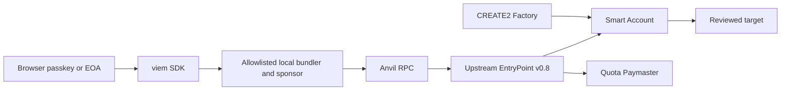
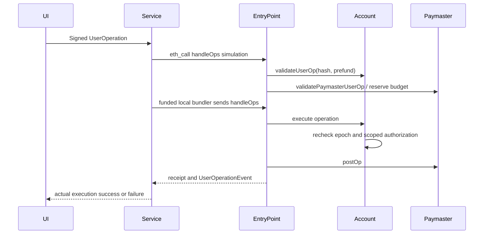
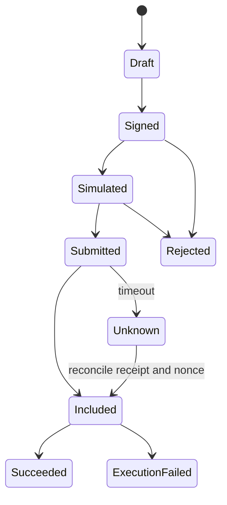

# Architecture, HLD, LLD and threat model

## Work breakdown and dependencies
P0 specification/version evidence → P1 design/threats → P2 account/factory/EntryPoint tests → P3 advanced authorization/paymaster → P4 negative/fuzz/invariants → P5 frozen review and fixes → P6 SDK/service/browser integration → P7 isolated chain deployment/public authorization gate → P8 teaching and dual acceptance. Do not mark future work complete through this document.

## Trust boundaries / ADR-001
Use the audited upstream EntryPoint implementation, not a teaching replacement. Use immutable EntryPoint and non-upgradeable accounts (simpler trust boundary; upgrades require new deployment). Account owners govern authority only through threshold-approved UserOperations. EntryPoint is privileged to call execution. A malicious configured EntryPoint defeats authorization, so pin codehash and address in deployment evidence. Trade-off: immutable contracts cannot patch bugs in place; recovery/migration must be documented.

## ADR-002: operation-specific authorization at execution
EntryPoint validates all operations before executing a bundle. A validation-time permission check alone is insufficient after a preceding operation revokes permissions. Store an authorization keyed by operation calldata hash and use a monotonically increasing policy epoch; execution rechecks epoch/time/policy. Execute authorization is bound to full payload, not a global last-signer variable. Sessions cannot manage account policy, call the account itself, or change guardians. Exact target/selector authorization is still trust in target behavior (proxy upgrades, token approvals, router semantics); only reviewed immutable targets should be allowlisted.

## ADR-003: paymaster reservation
An allowlisted sponsor signs the hash of the full unsigned operation payload plus paymaster, chain, EntryPoint, quota epoch and validity range. Reserve worst-case sponsorship in validation even if execution fails. This bounds depletion but may conservatively overcharge quota; budget unit is wei of worst-case gas, not actual refunded gas. Deposit availability differs from business quota. Sponsor compromise affects its remaining quota/deposit, not account ownership. Permissionless public mempool acceptance is not asserted; quota writes/shared storage require ERC-7562 review and potentially alternative mempool.

## Components

## Operation sequence / asset flow

## States and recovery

Never blindly resubmit a different operation after an ambiguous timeout. Hash/idempotency and nonce reconcile existing chain state. Server restart re-derives truth from transaction receipts; the filesystem store is not an entitlement authority.

## Access matrix
|Actor|Allowed|Forbidden|
|---|---|---|
|Owner threshold|execute/admin through signed operations|bypass threshold with direct EOA call|
|Session signer|exact target/selector within cumulative wei cap and validity|self/admin/delegatecall/arbitrary target|
|Passkey holder|owner-equivalent only while registered/current epoch|wrong RP/origin/challenge/no UV|
|Guardian threshold|propose delayed owner replacement|immediate transfer or arbitrary execution|
|Sponsor signer|bounded scoped gas authorization|account transaction authorization|
|Bundler|simulate/submit signed operations|forge signatures or spend account funds|
|Unauthenticated service client|read bounded public status|unbounded sponsoring/API/RPC proxy|

## Threat / invariant catalog
INV-01 no call without current authorization; INV-02 one chain/EntryPoint nonce consumed at most once; INV-03 any failed batch rolls back target state; INV-04 session cumulative native value <= budget and session cannot self-call; INV-05 threshold signers unique, configured and current; INV-06 recovery requires threshold, delay and current guardian policy; INV-07 all active sessions/passkeys/old owners invalid after recovery/epoch change; INV-08 sponsorship reservation <= configured quota, failed execution still consumes budget; INV-09 receipt inclusion != execution success; INV-10 secrets stay local and RPC/service bind loopback.

Attacks: phishing/signed calldata deception, replay across chains/accounts, revoked queued operations, delegatecall/storage takeover, reentrancy, allowance bypass, recovery griefing/collusion, paymaster depletion, API DoS, malicious RPC, fee spikes. Fail closed on wrong chain/EntryPoint, malformed calldata/signature, stale epoch and oversized input. Explicit residual risks include owner/guardian compromise, target behavior changes, frontend origin compromise, RPC censorship and service availability.

## Economic and gas model
Prefund is conservatively bounded by verificationGasLimit + callGasLimit + preVerificationGas plus paymaster verification/postOp limits, multiplied by maxFeePerGas; the deployed v0.8 EntryPoint implementation remains authoritative. ETH and quota use integer wei; all gas limit packing uses uint128 halves. No USD claim or fixed transaction price. Local mock ETH is not a cost forecast. Monitor deposit, reserved quota, simulation failures, receipt errors and stuck nonces. Never increase fees without the user's signed maxFee bounds.

## Recovery concurrency remediation
Recovery proposals are independent and addressed by ID. The latest-proposal fields are UI conveniences, never the sole recovery authority. Even if one guardian continuously proposes alternatives, a valid threshold can approve and complete its own proposal by ID. All proposals bind the current policy epoch. Owner cancellation of all proposals rotates the epoch and consequently also invalidates sessions and passkeys.
