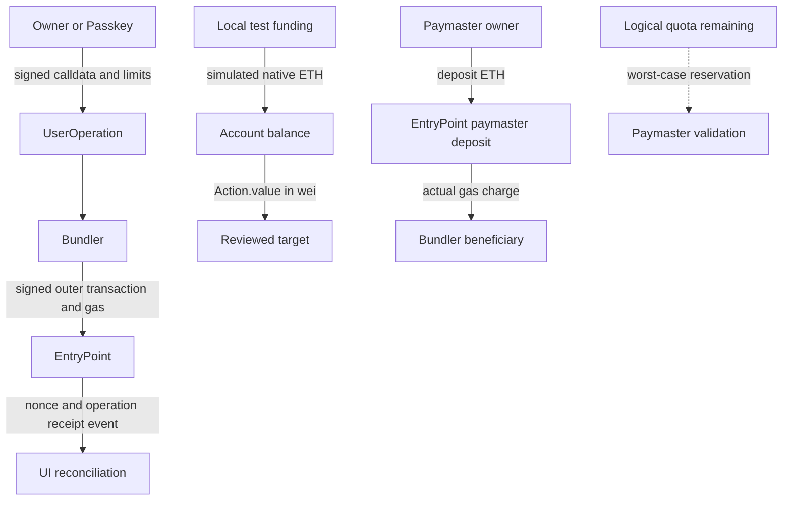

# Low-Level Design and operational contracts

本文件是实现/测试反馈后的详细设计迭代；最初架构与威胁模型在核心编码前建立于docs/architecture/design.md。不要把后补细节伪装成历史上已完成的验收。

## State and units
|数据|类型/单位|权威与失效规则|
|---|---|---|
|owner/guardian集合|address，最多10个，严格排序|链上集合与阈值，变更使epoch递增|
|epoch|uint256，策略版本|绑定calldata与Permit；旧版本不能执行|
|UserOperation nonce|uint256，192位key+64位sequence|EntryPoint负责唯一性；账户核对calldata完整nonce|
|Action.value|uint256 wei|账户native ETH转移，不等于Token数量|
|Session.remaining|uint256 wei|累计native预算；先扣再call，失败整体回滚|
|Session.validUntil|uint48，链时间秒|validation打包范围，执行时再检查；不是本机登录session|
|Permit|payloadHash→epoch/signer/mode|只由固定EntryPoint验证产生，只给相同calldata使用|
|Recovery|ID→owner/readyAt/votes/epoch/active|不同ID独立；只有当前策略、阈值、延迟均满足才可完成|
|Paymaster quota|uint256 wei，最坏费用预算|验证时预留；不承诺按实际费用退业务额度|
|Paymaster deposit|EntryPoint实际ETH余额|用于协议gas结算，与quota分开|
|Service record|userOpHash→signedrawtx/hash/status|fsync后才广播；链上nonce/receipt仍是权威|

## Key operations
|入口|输入与前置条件|后置条件|失败/安全检查|
|---|---|---|---|
|Factory.createAccount|owner/guardian非零，salt32字节，固定EP有代码|唯一CREATE2地址创建或返回已有账户|参数包含在creationCode hash，不能抢先偷换initializer|
|validateUserOp|仅固定EP；完整nonce/epoch与非空≤16actions；有效mode签名|保存准确payload Permit，返回正确validationData|错误签名返回1；畸形解析捕获；prefund由BaseAccount处理|
|executeOperation|仅固定EP；当前Permit与epoch；非重入|依次普通call，全部成功发Executed|session重查time/scope/budget；任一失败抛CallFailed并回滚业务状态|
|setOwners/Guardians|onlySelf且列表/阈值合法|替换集合、发配置事件、epoch递增|旧票/旧签名不能继承到新策略|
|setSession|onlySelf；key非零；reviewed target有代码；有效期未来|记录target/selector/native预算和新epoch|禁止账户自身与EP作为session目标|
|setPasskey|onlySelf，单签策略，公开坐标/RP/origin有效格式|owner授权登记凭据并绑定新epoch|并非设备attestation认证；实际断言仍做完整签名和上下文检查|
|propose/approveRecovery|当前guardian，按ID未重复投票|独立提案票数增加|一个guardian不能占唯一全局槽；旧epoch拒绝|
|completeRecovery|当前提案、阈值、两天延迟、非执行期间|替换owners，新epoch全面撤销旧授权|不能由恢复直接执行任意业务调用|
|validatePaymasterUserOp|仅EP；版本化sponsor签名、时间、quota足够|先预留maxCost，空context无postOp工作|修改任何已绑定字段使签名无效；revert也计预算|
|Service.submit|登记账户、输入schema、SDK/EP hash一致、真实模拟|确定raw tx/hash→fsync→广播→receipt/event|不重新猜nonce签重试交易；传输失败503与确定验证失败400分开|

## API and state machine
JSON UI API：GET config/health/challenge/account/operation；POST accounts/prepare/simulate/submit/rpc。ERC-4337 JSON-RPC子集：eth_supportedEntryPoints、eth_chainId、eth_sendUserOperation、eth_estimateUserOperationGas、eth_getUserOperationReceipt、eth_getUserOperationByHash。

估算目前要求有效已签名本地操作，返回经过模拟验证的保守上界。没有宣称任意dummy signature、公共聚合器、7702、替换mempool或ERC-7562全兼容。所有API只监听loopback，POST要求允许Origin，body≤131072字节，240请求/分钟，最多10个开户与有限赞助总预算。

Draft → Signed → Simulated → Persisted/Submitted → Succeeded/ExecutionFailed；网络超时保持Submitted/Unknown并对账。Ethereum外层receipt success与UserOperation success必须分别读取。Service restart复用EntryPoint隔离的存储；RPC失联测试通过暂停/恢复隔离Anvil进程完成，不等于链冷启动、历史归档或公共reorg证明。

## Asset and data flow

Logical quota不是独立ETH资产池；未使用的协议gas预付款与业务quota退款不是同一件事。模拟不把正式链状态永久改变；只有实际receipt/event能确认业务结果。
